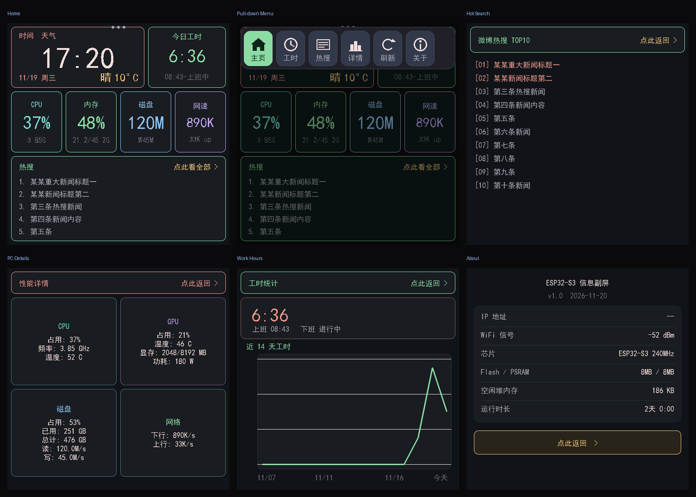

# ESP32-S3 桌面信息副屏

基于 **ESP32-S3 + 4 寸方屏** 的桌面副屏。屏幕常驻显示时钟、天气、PC 性能、微博热搜和工时统计，数据由局域网内的 PC 程序每 2 秒推送；屏幕本身也作为 HTTP 服务端，支持网页一键 OTA 升级。



> 截图来自 LVGL PC 模拟器（数据为演示值），与真机布局一致。

---

## 功能

| 页面 | 内容 |
|---|---|
| **首页** | 大时钟 + 日期 + 天气；今日工时；CPU / 内存 / 磁盘 / 网络 四格指标；热搜前 5 条预览 |
| **下拉菜单** | 顶部下拉（点击三点或下滑手势）弹出图标行：主页 / 工时 / 热搜 / 详情 / 刷新 / 关于，当前页高亮，可横向滑动 |
| **热搜页** | 微博热搜完整 Top 10 |
| **PC 详情页** | CPU/GPU 占用、温度、频率、显存、功耗；内存、磁盘读写、上下行速率 |
| **工时页** | 今日上班/下班时间、累计工时；近 14 天工时折线图 |
| **关于页** | IP、WiFi 信号、芯片型号、Flash/PSRAM、空闲堆、运行时长；实时刷新 |

其它能力：

- **局域网 OTA**：网页推送固件，屏幕显示进度条后自动重启（详见「OTA 升级」）
- **工时自动统计**：首次解锁电脑即上班，锁屏超过 2 小时视为下班；会议/上厕所等短暂锁屏自动忽略；跨天归属起始日，周末照常记录；断电重启不丢数据
- **天气屏端自取**：设备直接请求 wttr.in，英文字段自动转中文描述
- **数据掉线保护**：超过 10 秒没收到 PC 数据，界面置灰提示

---

## 硬件

| 项 | 规格 |
|---|---|
| 主控 | **ESP32-S3-WROOM-1U-N8R8**（8MB Flash + 8MB **OPI** PSRAM） |
| 屏幕 | 淘晶驰（晶驰）4 寸方形 480×480，**ST7701** 驱动，RGB 18bit 并口 |
| 触摸 | **GT911** 电容触摸，I2C |
| 接口 | USB-C（串口/供电）、TF 卡槽 |

屏幕排线与触摸排线是分开的。RGB 数据线定义为 16bit 并行（R/G/B 各 5/6/5，无 DB12），PCLK 12MHz，帧缓冲放在 PSRAM。

引脚定义见 [`firmware/config.h`](firmware/config.h)。

---

## 目录结构

```
.
├── firmware/                 # Arduino 固件（烧到 ESP32-S3）
│   ├── ESP32_SCREEN.ino      # 入口：WiFi 连接、启动 LVGL 任务、HTTP 服务
│   ├── config.h              # 引脚 / 分辨率 / Wi-Fi / 端口（需自行填写 Wi-Fi）
│   ├── common.h              # 日志宏与统一 include
│   ├── display.cpp/h         # 屏初始化、GT911 触摸、LVGL flush、系统信息读取
│   ├── scr_st7701_4inch_square.h  # ST7701 初始化序列
│   ├── gui.cpp/h             # 全部界面：5 个页面 + 下拉菜单 + 图表
│   ├── pcmon.cpp/h           # HTTP 服务端、JSON 解析、OTA 接收、SystemData
│   ├── weather.cpp           # 屏端拉取 wttr.in 并转中文
│   ├── Font*.c, icons.c      # 字库与图标（由脚本生成，见「字体与图标」）
│   ├── simhei_wx.ttf         # 字库源文件（已裁剪）
│   ├── gen_icons.py          # 生成 icons.c
│   ├── partitions.csv        # 8MB 双 OTA 分区表
│   └── —— PC 端 ——
│   ├── pc_agent.py           # Flask 网页配置 + 采集 + 推送 + OTA 转发
│   ├── work_monitor.py       # 工时状态机（锁屏检测 + 持久化）
│   └── eventlog_work.py      # 读取安全日志首次解锁时间（需管理员）
├── simulator/                # LVGL PC 模拟器（不烧录直接看界面）
├── docs/img/                 # 界面截图
└── README.md
```

---

## 快速开始

### 1. 固件

**环境**：Arduino IDE（或 arduino-cli），ESP32 Arduino 核心 **2.0.17**（请勿用 3.x）。

依赖库：

| 库 | 版本 |
|---|---|
| Arduino_GFX_Library | 1.4.7 |
| lvgl | 8.4.0 |
| TAMC_GT911 | — |
| ArduinoJson | 6.21.5 |

**Arduino IDE 板子设置**：

| 项 | 值 |
|---|---|
| Board | ESP32S3 Dev Module |
| Flash Size | 8MB |
| Partition Scheme | 8M Flash (3MB APP) —— 需自定义分区表时用 `partitions.csv` |
| PSRAM | **OPI PSRAM**（N8R8 必须） |
| USB CDC On Boot | Disabled |

> ⚠️ LVGL 的 `lv_conf.h` 中 `LV_MEM_SIZE` 必须 **≥ 96KB**。默认 48KB 时打开下拉菜单会因内存池耗尽卡死。

**命令行编译**：

```bash
arduino-cli compile \
  --fqbn "esp32:esp32:esp32s3:PSRAM=opi,FlashMode=qio,FlashSize=8M,PartitionScheme=min_spiffs,CDCOnBoot=default" \
  firmware
```

烧录后串口（115200）会打印 `WiFi: connected, IP=x.x.x.x`。

### 2. 配置

编辑 [`firmware/config.h`](firmware/config.h)：

```c
#define WIFI_SSID "YOUR_WIFI_SSID"
#define WIFI_PASS "YOUR_WIFI_PASSWORD"
```

### 3. PC 端

```bash
pip install flask requests psutil pynvml     # pynvml 仅 NVIDIA 显卡需要
pip install pywin32                          # 工时统计读取安全日志用
python pc_agent.py
```

浏览器打开 `http://localhost:5000`，填写：

- **屏幕 IP**（串口日志里看）
- **推送间隔**（默认 2 秒）
- **天气**：和风天气 API Key + LocationID（留空则用屏端自取天气）
- **GPU 开关**（仅 NVIDIA，需 pynvml）
- **第二/三指标**：在 内存 / 磁盘 / GPU / CPU 中选择

保存后后台线程立即开始推送。

> **工时统计说明**：精确的「首次解锁时间」需要读取 Windows 安全日志（事件 4800/4801），该操作要求**管理员权限**。非管理员运行时退化为轮询会话状态，精度稍差。

---

## 数据契约

PC → 屏 `POST /api/pc`（JSON）：

```json
{
  "cpu": 37.5, "cpu_temp": 52, "cpu_freq": 3850,
  "gpu": 21, "gpu_temp": 46, "gpu_mem_used": 2048, "gpu_mem_total": 8192, "gpu_power": 180,
  "mem": 48.1, "mem_used_gb": 21.2, "mem_total_gb": 45.2,
  "disk": 53, "disk_used_gb": 251, "disk_total_gb": 476,
  "disk_read": 120, "disk_write": 45, "disk_active": 63,
  "net_down": 890, "net_up": 33,
  "host": "DESKTOP",
  "time": "17:20", "date": "11-19",
  "year": 2026, "month": 11, "day": 19, "weekday": 2,
  "weather": { "temp": 12, "desc": "多云", "code": "na" },
  "hot": ["热搜标题 1", "热搜标题 2", "…"],
  "work": {
    "active": true, "start": "08:43", "end": "--:--", "minutes": 396,
    "hist": [0, 0, 211, 699, 396],
    "hist_date": ["11/07", "…", "11/20"]
  }
}
```

其它端点：

| 方法 | 路径 | 说明 |
|---|---|---|
| `GET` | `/` | 状态页 |
| `POST` | `/api/ota` | multipart 上传 `.bin` 固件，屏幕进度条显示后自动重启 |

---

## OTA 升级

`pc_agent.py` 网页里的 OTA 入口会把固件推给屏幕的 `POST /api/ota`，走 Arduino 的 `Update.h` + 双分区切换，失败会自动回滚到旧固件。

> **已知限制**：升级过程中屏幕会花屏闪烁。原因是 RGB 帧缓冲位于 OPI PSRAM，而 PSRAM 与 Flash 共享总线，写 Flash 时 DMA 读帧缓冲被干扰。这是硬件层面的限制，无法在软件上完全消除，但升级结束后会自动恢复正常显示。日常使用可无视。

---

## 字体与图标

- `FontGB2`（中文 + ASCII）：由 `simhei_wx.ttf` 经 `lv_font_conv` 生成，覆盖常用汉字与 `°`
- `FontNum_16/30/40/64`、`FontClock_64`：数字与符号
- `FontWeather_24/32`：天气描述与温度
- 全部为 1bpp，放在 Flash 中，不占 RAM

新增中文字符时需重新生成字库：

```bash
npx lv_font_conv --size 16 --bpp 1 --format lvgl --no-compress \
  --font firmware/simhei_wx.ttf --range 0x20-0x7F --symbols "新汉字" \
  -o firmware/FontCN.c --lv-include lvgl.h --lv-font-name FontGB2
```

图标（40×40 真彩色 + Alpha）由 `gen_icons.py` 生成。

---

## PC 模拟器

无需烧录即可在电脑上看界面、调布局（Windows + MSYS2 mingw64 + SDL2）：

```bash
cd simulator
cmake -G Ninja -B build . && cmake --build build
./build/esp32_screen_sim.exe                  # 实时窗口，鼠标即触摸
./build/esp32_screen_sim.exe --shot 0         # 截取首页为 shot.bmp
./build/esp32_screen_sim.exe --shot 0 menu    # 含下拉菜单
```

页面编号：`0` 首页 / `1` 热搜 / `2` 详情 / `3` 工时 / `4` 关于。

---

## 资源占用

| 项 | 占用 |
|---|---|
| 固件 | ≈ 1.58 MB / 3.75 MB 分区（42%） |
| 静态 RAM | ≈ 148 KB / 320 KB（内部 SRAM 剩约 179 KB） |
| LVGL 内存池 | 96 KB |
| PSRAM | 8 MB，帧缓冲约 450 KB，其余可用 |

---

## 已知问题

- **OTA 花屏**：见上文「OTA 升级」的硬件限制说明
- **CPU 温度**：Windows 下 psutil 无法读取 CPU 温度，该字段通常为 0
- **工时首次解锁**：需要管理员权限读取安全日志才准确
